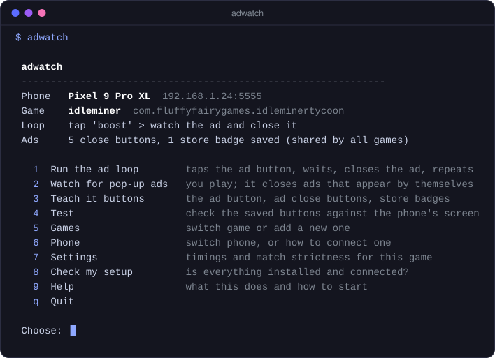

<p align="center">
  
</p>

<p align="center">
  <strong>Let your phone sit through the ads.</strong><br>
  adwatch taps the "watch an ad" button in Android games, waits the ad out, closes it, and goes again.
</p>

<p align="center">
  
  
  
  <a href="LICENSE"></a>
</p>

<p align="center">
  <a href="#install">Install</a> ·
  <a href="#first-run">First run</a> ·
  <a href="#how-it-works">How it works</a> ·
  <a href="#troubleshooting">Troubleshooting</a> ·
  <a href="#command-line">Command line</a>
</p>

<p align="center">
  <code>pipx install https://github.com/m0rg4n4-fae/adwatch/archive/refs/heads/main.zip</code>
</p>

<p align="center">
  
</p>

---

Free-to-play games make you watch a lot of ads to get anywhere. adwatch runs on your computer, controls the phone over USB or Wi-Fi, and does the tapping and waiting for you. You show it a game's ad button once; after that it works on its own.

- **Ad loop.** For "watch an ad for a reward" buttons. It taps the button, waits for the ad, closes it, and repeats as many times as you ask.
- **Watch mode.** For ads that pop up by themselves. You play as normal and it closes them when they appear.
- **Any game.** Nothing is built in for a particular game. A game is set up by boxing its button on a screenshot.
- **Close buttons are shared.** Every ad "X" you save works in all your games, and a starter set ships with adwatch.
- **Handles the awkward ads.** Ones that throw you into the Play Store, and ones you can only leave through the store.
- **Any phone size.** Saved buttons are rescaled, so the same ones work on a different phone.
- **Nothing on the phone.** No root and no app to install. It only takes screenshots and sends taps.

> [!NOTE]
> Early release. It is developed on Linux with a Pixel and a Galaxy phone. macOS and Windows should work but have not been tested yet, and watch mode has had less real-world use than the ad loop. Reports are welcome in [Issues](https://github.com/m0rg4n4-fae/adwatch/issues).

## Install

You need a computer with **Python 3.8 or newer** and an **Android phone**. Everything else is installed for you.

**With pipx (recommended)**

```sh
pipx install https://github.com/m0rg4n4-fae/adwatch/archive/refs/heads/main.zip
adwatch
```

No pipx? `python3 -m pip install --user pipx` gets it, or use `uv tool install git+https://github.com/m0rg4n4-fae/adwatch`. Plain pip works too: `pip install --user` followed by the same address.

**Without installing**

1. Click **Code → Download ZIP** at the top of this page and unzip it.
2. In that folder:

```sh
pip install -r requirements.txt
python adwatch.py
```

**The two things it can't install with pip**

- **adb**, Google's tool for talking to the phone. If it's missing, adwatch offers to download it from Google on first start.
- **Tkinter**, for the window where you box a button. It comes with Python on Windows and macOS. On Linux: `sudo apt install python3-tk`, `sudo pacman -S tk` or `sudo dnf install python3-tkinter`.

**Check my setup** in the menu tells you which of these are missing and how to fix each one.

To update later, run the install command again with `--force`.

## First run

1. **Turn on USB debugging** on the phone: Settings → About phone → tap *Build number* seven times, then Developer options → *USB debugging*. Plug the phone in and tap **Allow**. (Wireless debugging works too; the **Phone** screen in the menu explains it.)
2. **Start `adwatch`** and open the game on the phone.
3. **Games → Add a new game.** It asks how ads show up in that game and takes you to the next step.
4. **Teach it the ad button.** A window shows the phone's screen. Drag a box tightly around the button and press Enter.
5. **Run the ad loop** for one ad, and say yes to pausing. When an ad shows a close button it doesn't know, it stops and lets you box that button. Each one you save works in every game from then on.

For games where ads simply appear, skip steps 4 and 5 and choose **Watch for pop-up ads**.

In any prompt, Enter takes the value in `[brackets]`, `b` goes back, and Ctrl+C stops a run and returns to the menu.

## How it works

adwatch never touches the game's data. It looks at the screen and taps it, the way you would.

- **Seeing.** It takes a screenshot over adb and looks for the small pictures you saved. Matching uses outlines as well as brightness, so buttons that shimmer or glow are still found.
- **Closing ads.** It tries your saved close buttons first, then asks Android for anything on screen labelled *Close* or *Skip*. If an ad opens the Play Store or a browser, it presses Back until the game is in front again.
- **Knowing an ad is over.** In the ad loop, it waits until the game's own button is visible again before counting the ad as done. In watch mode, it checks which screen of the app is in front: full-screen ads run as a separate screen from the game.
- **Not overdoing it.** It only taps things it has matched. If it can't close an ad it presses Back a few times, then gives up on that ad instead of tapping blindly.

## The starter set

`adwatch/starter/` holds ad close buttons and store badges that are copied into every new user's collection on first start. If you've saved some that aren't in there, please share them:

```sh
python adwatch.py pack     # copies yours into adwatch/starter/, skipping duplicates
```

Then open a pull request with the new files. They are small crops of ad close buttons and contain nothing from your games.

## Where your things are kept

| How you run it | Games, saved buttons, settings |
|---|---|
| Installed (`adwatch`) | `~/.adwatch` |
| From the folder (`python adwatch.py`) | that folder (`profiles/`, `templates/`) |
| Either, with `ADWATCH_HOME` set | wherever it points |

`templates/common/` is your collection of ad close buttons. It works on any phone and in any game, so you can copy it to a friend.

## Troubleshooting

| Problem | What to do |
|---|---|
| No phone found | Open **Phone** in the menu. *unauthorized* means tap **Allow** on the phone. *offline* means toggle debugging off and on. |
| A button isn't found | Put it on screen and run **Test**. A score just under the limit: lower *Match strictness* in **Settings**. A very low score: save the picture again, boxed more tightly. |
| It taps the wrong spot or opens the store | The box was too wide. Taps land in the middle of the box, so re-save it tightly around the button. |
| An ad never gets closed | Run with pausing turned on and save its close button when it stops. |
| An ad only lets you out through Google Play | **Teach it buttons → Store badge**. It is only used when no close button shows up. |
| Watch mode misses an ad | That ad is drawn inside the game's own screen. Answer yes to "Also check inside the game's own screen?". |
| Watch mode calls a real game screen an ad | Put the game on that screen and run `adwatch watch GAME --learn`. |
| The box-drawing window doesn't open | Tkinter is missing. See [Install](#install). |

## Command line

Everything in the menu is also a command, for scripts and for people who prefer typing. `GAME` is the name you gave the game.

<details>
<summary>Commands</summary>

| Command | What it does |
|---|---|
| `adwatch` | the menu |
| `adwatch run GAME [-n N] [--teach]` | ad loop. `--teach` pauses on an ad it can't close so you can save its button |
| `adwatch watch GAME [-n N] [--minutes M] [--scan] [--teach] [--learn]` | close ads that appear by themselves |
| `adwatch new NAME` | add a game (have it open on the phone) |
| `adwatch grab GAME LABEL [flags]` | box a button on a live screenshot |
| `adwatch step GAME KIND ...` | add `watch_ad`, `wait N`, `key NAME` or `tap_xy X Y` to the loop |
| `adwatch test GAME` | score every saved picture against the current screen |
| `adwatch snap [OUT.png]` | save a screenshot |
| `adwatch get-adb` | download Google's adb |
| `adwatch pack` | copy your saved ad buttons into the starter set |

`grab` flags: `--then-ad` (tap it, then watch the ad), `--step` (just tap it), `--optional`, `--close` (an ad's X), `--stuck` (a store badge), `--open` (a button that opens the pop-up holding the ad button), `--ingame` (something only the game shows), `--delay N` (seconds before the screenshot).

`-s SERIAL` before the command picks a phone when several are connected.

</details>

<details>
<summary>Settings (in the menu, or in <code>profiles/GAME.json</code>)</summary>

| Key | Default | Meaning |
|---|---|---|
| `threshold` | 0.85 | how closely the screen must match a saved picture |
| `close_threshold` | same | the same, for ad close buttons only |
| `cycles` | 10 | ads per run |
| `ad_min_seconds` | 15 | ad loop: never close an ad before this, so the reward isn't lost |
| `passive_min_seconds` | 5 | watch mode: never close an ad before this |
| `ad_max_seconds` | 90 | no close button by now: press Back |
| `stuck_seconds` | 30 | no close button by now: use a saved store badge |
| `cooldown_seconds` | 5 | ad loop: pause between ads |

</details>

## Heads-up

Most games' terms don't allow automating ads, and ad networks look for it. Accounts can be restricted or banned. Use adwatch on accounts you can afford to lose, and keep runs modest. This project isn't affiliated with any game, ad network, or Google.

adb is downloaded from Google and is covered by the [Android SDK licence](https://developer.android.com/tools/releases/platform-tools), not by this project's.

## License

[MIT](LICENSE)
